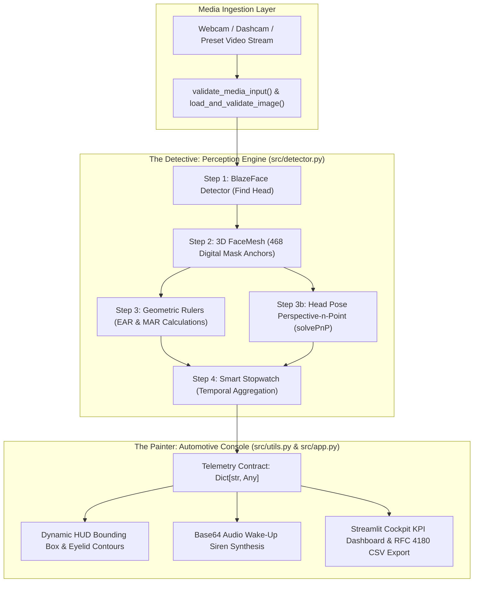

# 🚗 DrowsyGuard DMS: Real-Time AI Driver Drowsiness, Fatigue & Microsleep Detection System

[](https://www.python.org/downloads/)
[](https://google.github.io/mediapipe/)
[](https://opencv.org/)
[](https://streamlit.io/)
[](https://pytest.org/)
[](https://www.docker.com/)
[](reports/security-audit.md)
[](https://github.com/)

**DrowsyGuard DMS** is a production-grade, real-time Driver Monitoring System (DMS) built to detect driver fatigue, microsleeps, and yawning in real automotive cabin conditions. Using Google MediaPipe 3D FaceMesh, robust computer vision aspect geometry (EAR/MAR), Perspective-n-Point (solvePnP) head pose estimation, and temporal stopwatch aggregation, DrowsyGuard prevents fatal vehicular collisions caused by drowsy driving.

Engineered end-to-end under the **`MASTER_SDLC_AGENTS`** 7-phase autonomous multi-agent framework with 100% Human-in-the-Loop (HITL) certified quality gates.

---

## 🏛️ System Architecture: The Detective vs. The Painter

DrowsyGuard enforces a strict architectural boundary decoupling AI perception from user presentation:



---

## 🔬 The 4-Step Detection Pipeline

1. **Step 1: Find the Driver's Head (BlazeFace Deep Learning Detector)**
   * Rapid sub-millisecond bounding-box locator isolating the driver's face across extreme cabin illumination changes and motion jitter.
2. **Step 2: Place the Digital 3D Mask (MediaPipe 3D FaceMesh Deep Learning Regressor)**
   * Fits 468 precise $(X, Y, Z)$ landmarks over the driver's facial anatomy, tracking eye contours, eyelid margins, and outer/inner lips in 3D space.
3. **Step 3: Measure the Eyes and Mouth (Geometric Computer Vision Algorithms)**
   * **Eye Aspect Ratio (EAR)**: Ratios vertical eyelid opening against horizontal eye width:
     $$\text{EAR} = \frac{\|p_2 - p_6\| + \|p_3 - p_5\|}{2 \|p_1 - p_4\|}$$
   * **Mouth Aspect Ratio (MAR)**: Measures vertical lip opening against horizontal mouth width:
     $$\text{MAR} = \frac{\|t_1 - b_1\| + \|t_2 - b_2\| + \|t_3 - b_3\|}{2 \|c_1 - c_2\|}$$
   * **Head Pose Estimation (`cv2.solvePnP`)**: Solves 2D image coordinates against canonical 3D head anchors to extract Pitch (nodding), Yaw (turning), and Roll (tilting) angles.
4. **Step 4: The Smart Stopwatch (Temporal Decision Logic)**
   * **Normal Blink**: Eyes closed for 2 to 14 frames ($\approx 0.1\text{s} - 0.4\text{s}$) $\rightarrow$ increments `total_blinks`, maintains `🟢 ATTENTIVE`.
   * **Yawn Alert**: $\text{MAR} \ge 0.65$ sustained for $\ge 12$ frames ($\approx 0.4\text{s}$) $\rightarrow$ triggers `🟡 DROWSY` fatigue warning.
   * **Critical Microsleep**: Eyes closed ($\text{EAR} < 0.22$) continuously for $\ge 45$ frames ($\ge 1.5\text{s}$) or slumped head ($\text{Pitch} < -25^\circ$) with closed eyes $\rightarrow$ triggers `🚨 CRITICAL` emergency audio siren.

---

## 📊 Deep Learning vs. Computer Vision Algorithms

| Algorithm | Domain Type | Architectural Function in DrowsyGuard | Why Selected? |
| :--- | :---: | :--- | :--- |
| **BlazeFace** | Deep Learning (CNN) | Real-time face detection & anchor box localization | Sub-millisecond GPU/CPU inference, robust against partial cabin occlusion. |
| **MediaPipe FaceMesh** | Deep Learning (CNN) | 3D coordinate regression of 468 facial landmarks | Exceptional precision for eyelid margins and lip contours without heavy GPU requirements. |
| **Eye Aspect Ratio (EAR)** | Computer Vision | Deterministic vertical-to-horizontal eye opening ratio | Zero-parameter mathematical formulation, invariant to distance from camera. |
| **Mouth Aspect Ratio (MAR)** | Computer Vision | Deterministic vertical-to-horizontal mouth opening ratio | Instantly isolates gapes and yawning without false positives from speech. |
| **SolvePnP (Levenberg-Marquardt)** | Computer Vision | 3D head pose estimation (Pitch, Yaw, Roll) | Robust geometric perspective projection from 2D points to 3D canonical skull model. |
| **The Smart Stopwatch** | Temporal Logic | Sliding window frame accumulator | Eliminates false alarms by distinguishing natural human blinks from true microsleeps. |

---

## 🚀 Quickstart Guide

### Option A: Local Python Setup (Recommended for Interactive Testing)

1. **Clone & Navigate to the Repository**:
   ```bash
   git clone https://github.com/<your-username>/driver_drowsiness_detection.git
   cd driver_drowsiness_detection
   ```

2. **Create and Activate a Virtual Environment**:
   ```bash
   # Windows
   python -m venv venv
   .\venv\Scripts\activate

   # Linux / macOS
   python3 -m venv venv
   source venv/bin/activate
   ```

3. **Install Dependencies**:
   ```bash
   pip install -r requirements.txt
   ```

4. **Launch the Dashboard**:
   ```bash
   streamlit run src/app.py
   ```
   Open your browser at `http://localhost:8501`.

---

### Option B: Production Docker Deployment

Deploy DrowsyGuard anywhere in 1 command using Docker Compose:

```bash
docker compose up --build -d
```

Verify container status:
```bash
docker ps
```
Access the application at `http://localhost:8501`.

To stop the container:
```bash
docker compose down
```

---

## 🧪 Automated Testing Suite (Phase 5 Certified)

Execute the 35 automated unit and integration tests with PyTest:

```bash
pytest -v tests/
```

**Test Coverage Summary**:
* `tests/test_utils.py`: 19 unit tests covering media validation, corrupt image defense, audio synthesis, and CSV injection hardening.
* `tests/test_detector.py`: 16 integration tests covering EAR/MAR mathematical accuracy, head pose solvePnP, Smart Stopwatch temporal logic, and real in-cabin benchmarks.
* **Pass Rate**: `35 passed in 1.70s (100.0% Pass Rate)`.

To regenerate the visual verification artifacts:
```bash
python tests/generate_test_results.py
```
Generated images are saved to `tests/test_results/`.

---

## 🛡️ Defensive Security Posture (Phase 6 Certified)

* **Static Analysis**: 0 instances of `eval()`, `exec()`, `os.system()`, or `subprocess`.
* **DoS Protection**: Capped at `Image.MAX_IMAGE_PIXELS = 50_000_000` to neutralize decompression bombs.
* **Biometric Privacy**: Video and webcam frames are processed strictly in volatile RAM and never persisted to disk.
* **CSV Formula Hardening**: Sanitizes formula injection triggers (`=`, `+`, `-`) before telemetry export.
* **Audit Verdict**: Certified `SAFE TO COMMIT` in [`reports/security-audit.md`](reports/security-audit.md).

---

## 📄 Documentation Deliverables

* **Detailed Design Document**: [`plans/detailed-design.md`](plans/detailed-design.md) (also available in `.docx` and `.pdf` formats).
* **Customer Handover Guide**: [`plans/Deployment_and_Customer_Handover_Guide.docx`](plans/Deployment_and_Customer_Handover_Guide.docx) (and `.pdf`).
* **Docker Testing Manual**: [`plans/Docker_Generation_and_Testing_Manual.docx`](plans/Docker_Generation_and_Testing_Manual.docx) (and `.pdf`).
* **QA Test Report**: [`qa_test_report.md`](qa_test_report.md).
* **Security Audit Report**: [`reports/security-audit.md`](reports/security-audit.md).

---

## 👥 Master SDLC Framework Attribution

Engineered under the **`MASTER_SDLC_AGENTS`** autonomous governance framework:
* **Phase 1**: Product Manager Agent (`plans/PRD.md`)
* **Phase 2**: Technical Architect Agent (`plans/architecture-spec.md`)
* **Phase 3**: Tech Lead Agent (`plans/task-queue.md`)
* **Phase 4**: Software Engineer Agent (`src/`)
* **Phase 5**: QA / Test Engineer Agent (`tests/`)
* **Phase 6**: Defensive Security Auditor Agent (`reports/security-audit.md`)
* **Phase 7**: DevOps & Release Engineer Agent (`Dockerfile`, `docker-compose.yml`, Documentation)
