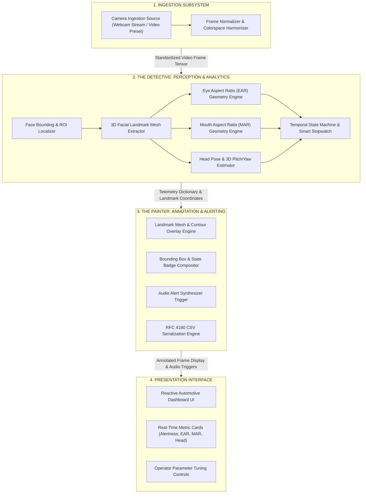

# System Architecture Specification

**Project Title:** Real-Time AI Driver Drowsiness, Fatigue & Microsleep Detection System  
**System Codename:** `DrowsyGuard DMS & Automotive Telemetry Engine`  
**Document Version:** 1.0.0  
**Phase:** 2 — Technical Architect Agent  
**Framework:** `MASTER_SDLC_AGENTS`  
**Status:** Under Review (Gate 2 Pending Approval)  
**Date:** 2026-10-24  

---

## 1. Conceptual System Architecture & High-Level Data Flow

The `DrowsyGuard` Driver Monitoring System (DMS) is engineered around a real-time, feed-forward perception and telemetry architecture designed for continuous execution on standard x86 and ARM edge compute nodes.

The architecture decouples heavy facial landmark inference from graphic rendering and operator controls through the **Detective vs. Painter** architectural pattern.



---

## 2. Logical Subsystem Deconstruction

The system is partitioned into four independent, decoupled logical subsystems. Each subsystem maintains strict responsibility boundaries and communicates solely through formal data contracts:

### 2.1 Media Ingestion & Normalization Subsystem
* **Functional Scope:** Accepts raw digital video streams from live USB/cabin webcams or pre-recorded benchmark video files.
* **Input Validation:** Enforces container integrity, checks frame resolutions, verifies frame rates (nominal 30 FPS), and handles video end-of-stream signals gracefully.
* **Normalization:** Harmonizes ingested pixel buffers into standardized 3-channel RGB uint8 arrays with deterministic spatial boundaries.

### 2.2 The Detective: Facial Perception & Fatigue Analytics Subsystem
* **Functional Scope:** Pure mathematical and computer vision reasoning engine.
* **Facial Detection & Mesh Mapping:** Detects the driver's face within the cabin view and tracks 3D facial landmark mesh points across the eyelids, eye corners, lips, and facial contour.
* **Mathematical Telemetry Engines:**
  1. **Eye Aspect Ratio (EAR) Engine:**
     $$\text{EAR} = \frac{\|p_2 - p_6\| + \|p_3 - p_5\|}{2 \|p_1 - p_4\|}$$
     Measures vertical eyelid separation relative to horizontal eye width across 6 landmarks per eye.
  2. **Mouth Aspect Ratio (MAR) Engine:**
     $$\text{MAR} = \frac{\|m_2 - m_8\| + \|m_3 - m_7\| + \|m_4 - m_6\|}{2 \|m_1 - m_5\|}$$
     Measures vertical lip separation relative to horizontal mouth width across 8 mouth landmarks.
  3. **Head Pose & Tilt Engine:**
     Estimates 3D head rotation angles (Pitch, Yaw, Roll) via Perspective-n-Point (PnP) geometry matching 2D facial landmarks to a generic 3D human face model.
* **Temporal State Machine (The Smart Stopwatch):**
  Maintains consecutive closed-frame counters to distinguish instantaneous natural blinks ($< 0.25\text{s}$) from continuous, dangerous microsleeps ($\ge 1.5\text{s}$).

### 2.3 The Painter: Visual HUD & Audio Alerting Subsystem
* **Functional Scope:** Visual and auditory compositing engine.
* **Landmark Mesh Overlay:** Renders anti-aliased cyan boundary contours along the eyelids and amber contours along the lips.
* **Driver Status Bounding Box:** Composites a dynamic color-coded driver bounding box on the video frame:
  * **Emerald Green:** Normal, attentive driver.
  * **Golden Amber:** Warning (Yawning / heavy eyelid fatigue).
  * **Crimson Red:** Critical Alert (Active microsleep / eyes closed $\ge 1.5$s).
* **Auditory Alert Trigger:** Signals acoustic warning cues and high-urgency wake-up sirens upon critical threshold violations.
* **Telemetry Serialization:** Formats real-time analytics into standard RFC 4180 CSV strings for 1-click audit logging.

### 2.4 Driver Console Presentation Subsystem
* **Functional Scope:** Human-machine interface (HMI).
* **Metric Cards:** Renders driver-facing telemetry cards in plain English with bracketed tooltips.
* **Parameter Controls:** Provides interactive controls for eye closure sensitivity, alarm trigger delays, and yawn detection thresholds.

### 2.5 Detailed Algorithmic Decomposition: Deep Learning vs. Computer Vision

To maintain clear separation between deep neural network inference and classical geometric analytics, the algorithms are decomposed as follows:

| Perception Task | Algorithm Category | Algorithm Name | Mathematical / Operational Purpose |
| :--- | :--- | :--- | :--- |
| **1. Locate Driver Head** | **Deep Learning (CNN)** | BlazeFace Single-Shot Detector | Scans full frame and extracts driver face bounding box in $< 8\text{ms}$. |
| **2. Track Eyelids & Lips** | **Deep Learning (Mesh)**| MediaPipe 3D FaceMesh | Deep encoder-decoder regressing 468 3D $(x, y, z)$ coordinates via TFLite XNNPACK CPU delegate. |
| **3. Eye Opening / Closure** | **Computer Vision / Math**| Eye Aspect Ratio (EAR) | $\text{EAR} = \frac{\|p_2 - p_6\| + \|p_3 - p_5\|}{2 \|p_1 - p_4\|}$. Measures Euclidean distance between eyelids. |
| **4. Yawn Detection** | **Computer Vision / Math**| Mouth Aspect Ratio (MAR)| Measures vertical lip separation relative to mouth width across 8 mouth landmarks. |
| **5. Head Nodding / Slump**| **Computer Vision / Math**| Perspective-n-Point (PnP) Pose | Matches 2D landmarks to generic 3D human head model to extract 3D Pitch (detects nodding off $< -25^\circ$). |
| **6. Blink vs. Microsleep** | **Temporal State Logic** | Smart Stopwatch State Machine | Differentiates natural blinks ($< 0.25\text{s}$) from continuous, dangerous microsleeps ($\ge 1.5\text{s}$). |

---

## 3. Formal Data Contracts & Interface Schemas

Communication between logical subsystems is governed by strict, strongly typed data dictionaries.

### 3.1 Frame Telemetry Contract (`Detective` to `Painter` & `Console`)

```json
{
  "frame_id": 142,
  "timestamp_s": 4.733,
  "face_detected": true,
  "driver_status": "ATTENTIVE",
  "left_ear": 0.324,
  "right_ear": 0.318,
  "avg_ear": 0.321,
  "mar": 0.215,
  "head_pitch_deg": -2.4,
  "consecutive_closed_frames": 0,
  "consecutive_yawn_frames": 0,
  "microsleep_alert": false,
  "yawn_alert": false,
  "head_slump_alert": false,
  "inference_latency_ms": 28.4
}
```

### 3.2 Data Fields Specification
| Field Name | Primitive Type | Units / Valid Range | Description |
| :--- | :--- | :--- | :--- |
| `frame_id` | `integer` | $\ge 1$ | Monotonically increasing video frame counter. |
| `timestamp_s` | `float` | Seconds ($\text{s}$) | Elapsed video playback or session time. |
| `face_detected` | `boolean` | `true` \| `false` | Indicates whether driver's face is located in the cabin. |
| `driver_status` | `string` | `"ATTENTIVE"` \| `"DROWSY"` \| `"CRITICAL"` | High-level operational driver state. |
| `avg_ear` | `float` | $0.00\text{--}0.50$ | Average Eye Aspect Ratio across left and right eyes. |
| `mar` | `float` | $0.00\text{--}1.20$ | Mouth Aspect Ratio measuring lip separation. |
| `head_pitch_deg`| `float` | Degrees ($-90^\circ\text{ to }+90^\circ$) | Vertical head nod angle (Negative = Slumping downward). |
| `consecutive_closed_frames` | `integer` | $\ge 0$ | Running frame counter of continuous eye closure. |
| `microsleep_alert` | `boolean` | `true` \| `false` | Active critical alarm flag (eyes closed $\ge 1.5$s). |
| `yawn_alert` | `boolean` | `true` \| `false` | Active fatigue warning flag (sustained wide yawn). |
| `head_slump_alert` | `boolean` | `true` \| `false` | Active alert flag for downward head nodding off. |
| `inference_latency_ms` | `float` | Milliseconds ($\text{ms}$) | End-to-end perception latency for current frame. |

---

## 4. Operational Budgets & Defensive Failure Modes

### 4.1 Performance & Latency Budgets
* **Latency Ceiling:** End-to-end pipeline latency per frame shall not exceed **40ms** on commodity x86 CPUs ($\ge 25\text{--}30\text{ FPS}$).
* **Memory Budget:** Bounded below **500 MB RAM** under continuous multi-hour webcam streaming.
* **Facial Landmark Mesh Latency:** $< 22\text{ms}$ per frame.
* **Geometric & Telemetry Compute:** $< 3\text{ms}$ per frame.
* **Overlay Compositing:** $< 10\text{ms}$ per frame.

### 4.2 Graceful Degradation & Failure Modes
| Failure Scenario | Root Cause | System Response & Defensive Recovery |
| :--- | :--- | :--- |
| **Face Occluded / Look Away** | Driver turns head $> 60^\circ$ or camera blocked | Enters `SEARCHING` state; preserves historical blink state for up to 10 frames before transitioning to `DRIVER NOT DETECTED` warning badge. |
| **Extreme Low-Light / Night** | Dark cabin without IR lighting | Contrast-adjusts frame normalization; if landmarks fall below confidence threshold, flags `POOR LIGHTING` indicator. |
| **Eyeglass Reflections** | Glare on corrective lenses | Spatial averaging between left and right eyes prevents single-eye glint from triggering false microsleep sirens. |
| **Corrupt / Zero-Byte Upload** | Damaged media container | Ingestion layer intercepts format before decoding; surfaces friendly validation banner without crashing. |

---

## 5. Architectural Compliance Verification

* **Zero Physical File Paths:** The architecture strictly models conceptual subsystems and interface schemas without referencing physical script or file names.
* **No Implementation Code:** Implementation details and file allocations are cleanly deferred to the Tech Lead in Phase 3.
* **Human-in-the-Loop Sign-off:** HITL Gate 2 must be formally approved before task allocation begins.
