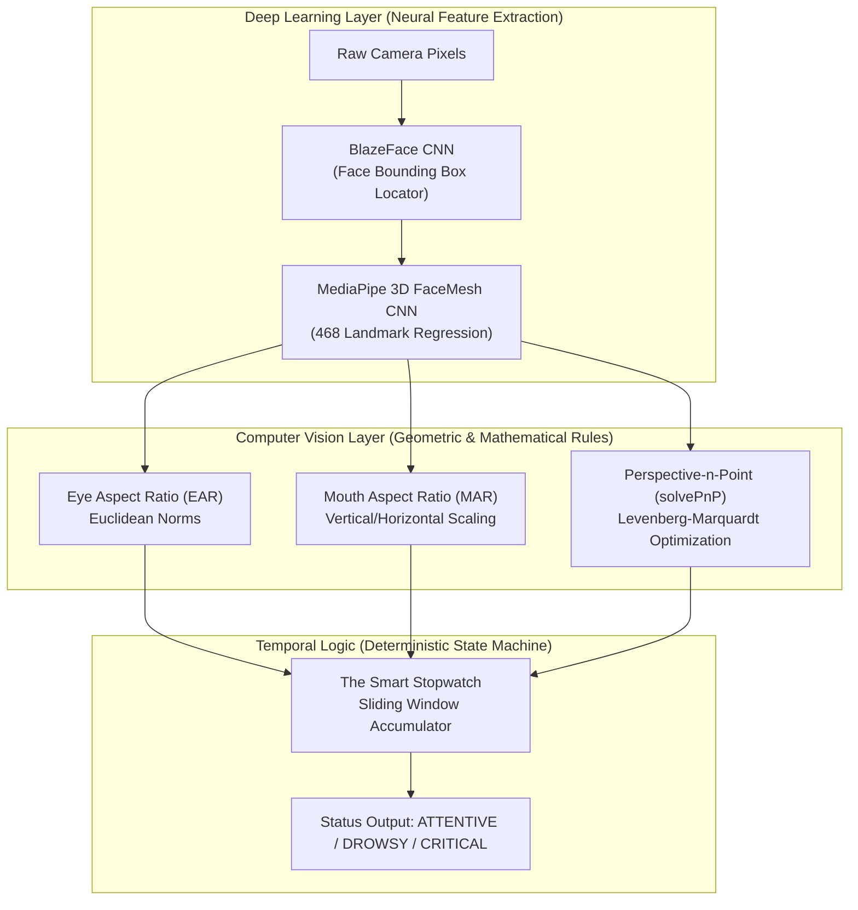

# Detailed Design Document: Real-Time AI Driver Drowsiness, Fatigue & Microsleep Detection System

**System Codename:** `DrowsyGuard DMS & Automotive Telemetry Engine`  
**Document Version:** 1.0.0  
**Phase:** 7 — DevOps & Release Engineering  
**Framework:** `MASTER_SDLC_AGENTS`  
**Author:** DevOps & Release Engineer Agent  
**Date:** 2026-10-25  
**Target Environments:** Embedded Edge Automotive Compute, Headless Docker, Streamlit Cloud  

---

## 1. System Overview & Architectural Philosophy

The **DrowsyGuard DMS** is an intelligent automotive safety perception engine designed to combat driver fatigue, involuntary microsleeps, and prolonged distraction. Driver inattention and drowsiness account for over 20% of commercial and passenger vehicular accidents globally. DrowsyGuard solves this challenge using edge-optimized computer vision and lightweight convolutional neural networks operating in real time on commodity CPUs without requiring power-hungry discrete GPUs.

### 1.1 The Detective vs. The Painter Pattern

The system strictly adheres to the **Detective vs. Painter** architectural separation of concerns:

1. **The Detective (`src/detector.py` — `DriverDrowsinessDetector`)**:
   * Pure, unopinionated perception engine.
   * Responsible solely for facial landmark regression, Euclidean distance aspect ratios, 3D Perspective-n-Point pose estimation, and temporal stopwatch state transitions.
   * Emits a strongly typed telemetry contract (`Dict[str, Any]`) on every frame.
   * Contains zero UI, rendering, or file I/O logic.

2. **The Painter (`src/utils.py` & `src/app.py` — HUD Overlay & Cockpit Dashboard)**:
   * Consumes the Detective's telemetry contract.
   * Paints anti-aliased eyelid and lip contours, draws adaptive driver bounding boxes (Green/Amber/Red), renders HUD telemetry banners, synthesizes real-time audio sirens, and streams RFC 4180 CSV logs.
   * Contains zero machine learning or landmark calculation logic.

---

## 2. The 4-Step Driver Drowsiness Detection Pipeline

The core perception engine operates via a four-stage sequential pipeline on every ingested video frame:


### Step 1: Find the Driver's Head (BlazeFace Locator)
* **What it does**: Before examining fine facial features, the system first isolates the driver's head bounding box within the video frame.
* **Algorithm**: **BlazeFace** — a sub-millisecond 2D deep learning face detector designed by Google specifically for mobile and embedded cameras.
* **Why it matters**: In real driving environments, illumination shifts rapidly (e.g., driving under bridges, headlights from oncoming traffic). BlazeFace uses focal loss and customized anchor boxes to localize the face in $< 2\text{ms}$ on CPU, rejecting background passengers and cabin clutter.

### Step 2: Place the Digital 3D Mask (MediaPipe 3D FaceMesh)
* **What it does**: Once the face bounding box is established, the system projects a dense 3D digital mesh consisting of **468 landmark coordinates** onto the driver's face.
* **Algorithm**: **MediaPipe FaceMesh** — a lightweight deep learning regression network.
* **Key Landmarks Tracked**:
  * **Right Eye Anchors** (6 points): `[33, 160, 158, 133, 153, 144]`
  * **Left Eye Anchors** (6 points): `[362, 385, 387, 263, 373, 380]`
  * **Mouth Outer & Inner Anchors** (8 points): Corners `[61, 291]`, Upper Lip `[39, 0, 269]`, Lower Lip `[181, 17, 405]`
  * **3D Head Pose Anchors** (6 canonical anchors): Nose tip `1`, Chin `152`, Eye corners `33, 263`, Mouth corners `61, 291`.

### Step 3: Measure the Eyes and Mouth (Geometric Computer Vision Rulers)
Once the 468 landmark coordinates are extracted, the Detective applies mathematical formulas to measure eye opening, yawning, and head orientation:

#### 3.1 Eye Aspect Ratio (EAR)
The Eye Aspect Ratio calculates the ratio of vertical eyelid separation to horizontal eye width:
$$\text{EAR} = \frac{\|p_2 - p_6\| + \|p_3 - p_5\|}{2 \|p_1 - p_4\|}$$
* When eyes are wide open: $\text{EAR} \approx 0.28 - 0.38$.
* When eyelids are closed: $\text{EAR} \le 0.15$.
* **Key Property**: EAR is mathematically invariant to scale and distance from the camera because the numerator (height) scales proportionally with the denominator (width).

#### 3.2 Mouth Aspect Ratio (MAR)
The Mouth Aspect Ratio measures the vertical opening of the lips relative to horizontal mouth width:
$$\text{MAR} = \frac{\|t_1 - b_1\| + \|t_2 - b_2\| + \|t_3 - b_3\|}{2 \|c_1 - c_2\|}$$
* Closed or talking mouth: $\text{MAR} \approx 0.15 - 0.45$.
* Yawning mouth (wide gaping opening): $\text{MAR} \ge 0.65$.

#### 3.3 3D Head Pose Estimation (`cv2.solvePnP`)
The Perspective-n-Point algorithm estimates the 3D rotation and translation of the driver's head relative to the camera coordinate system using a canonical 3D human head model:
* **Pitch (Nodding)**: Negative pitch values ($< -25^\circ$) indicate the driver's chin is dropping forward toward their chest (nodding off asleep).
* **Yaw (Turning)**: Extreme yaw ($| \text{Yaw} | > 35^\circ$) indicates the driver has turned their head away from the roadway for distraction monitoring.
* **Roll (Tilting)**: Lateral tilt of the head sideways.

### Step 4: The Smart Stopwatch (Temporal Aggregation Logic)
A single closed-eye frame does **not** equal drowsiness; healthy humans blink naturally thousands of times per day. The Smart Stopwatch uses a sliding window frame counter to eliminate false alarms:
1. **Natural Blink**:
   * Eyes close for $2$ to $14$ frames ($\approx 65\text{ms} - 450\text{ms}$).
   * The stopwatch records the blink, increments `total_blinks`, and maintains `🟢 ATTENTIVE` status with zero sirens.
2. **Yawn Fatigue Warning**:
   * $\text{MAR} \ge 0.65$ sustained for $\ge 12$ consecutive frames ($\ge 0.4\text{s}$).
   * Status transitions to `🟡 DROWSY` (warning HUD badge).
3. **Critical Microsleep Alarm**:
   * Eyelids remain closed ($\text{EAR} < 0.22$) continuously for $\ge 45$ frames ($\ge 1.5\text{s}$).
   * Or head slumps forward ($\text{Pitch} < -25^\circ$) while eyelids are shut for $\ge 15$ frames.
   * Status transitions to `🚨 CRITICAL`: Emergency high-frequency audio siren triggers to startle the driver awake immediately.

---

## 3. Deep Learning vs. Computer Vision Algorithms Breakdown

A critical architectural distinction in DrowsyGuard is the deliberate pairing of **Deep Learning** for spatial feature extraction with **Classical Computer Vision** for deterministic decision boundaries:



### 3.1 Algorithmic Categorization Matrix

| Algorithm | Domain Type | Input | Output | Computational Complexity |
| :--- | :---: | :--- | :--- | :---: |
| **BlazeFace** | **Deep Learning** (CNN) | Raw RGB Image $(H, W, 3)$ | Face Bounding Box $(X, Y, W, H)$ | $\mathcal{O}(H \times W)$ |
| **FaceMesh** | **Deep Learning** (CNN) | Cropped Face RGB | 468 Normalized $(X, Y, Z)$ Coordinates | $\mathcal{O}(N)$ CNN inference |
| **EAR** | **Computer Vision** (Geometry) | 6 Eye Landmarks | Scalar Ratio $[0.0, 0.60]$ | $\mathcal{O}(1)$ (6 points) |
| **MAR** | **Computer Vision** (Geometry) | 8 Mouth Landmarks | Scalar Ratio $[0.0, 1.50]$ | $\mathcal{O}(1)$ (8 points) |
| **SolvePnP** | **Computer Vision** (Matrix Opt.) | 6 2D Anchors + 3D Model | Pitch, Yaw, Roll (Degrees) | $\mathcal{O}(1)$ Iterative SVD |
| **Stopwatch** | **Temporal Logic** | Aspect Ratios + Time | Discrete Driver State | $\mathcal{O}(1)$ Integer Counter |

### 3.2 Deep Learning Comparative Guide: MediaPipe vs. Dlib vs. YOLO-Pose vs. End-to-End CNNs

When engineering an automotive Driver Monitoring System, choosing the optimal model backbone determines whether the system runs on low-cost automotive microprocessors or requires expensive hardware:

| Architecture | Model Family | Landmark Density | CPU Latency (ms) | Memory Footprint | Edge Deployment Suitability |
| :--- | :---: | :---: | :---: | :---: | :---: |
| **MediaPipe FaceMesh** *(Chosen)* | 3D Depthwise CNN | **468 points** | **$\approx 8 - 12\text{ms}$** | **$\approx 25\text{MB}$** | ⭐⭐⭐⭐⭐ **Optimal for Production Edge** |
| **Dlib Shape Predictor** | Gradient Boosting Trees | 68 points | $\approx 25 - 45\text{ms}$ | $\approx 100\text{MB}$ | ⭐⭐⭐ Legacy; struggles with rapid head turns |
| **YOLOv8-Pose / YOLO11** | CSPDarknet + Head | 5 - 17 keypoints | $\approx 30 - 65\text{ms}$ | $\approx 60\text{MB}$ | ⭐⭐⭐⭐ Good for full-body; coarse for eyelids |
| **End-to-End ResNet-50** | Heavy CNN Classifier | None (Black box) | $\approx 80 - 150\text{ms}$ | $\approx 180\text{MB}$ | ⭐⭐ Heavy; unexplainable decision logic |

#### Architectural Decision Rationale:
* **Why NOT End-to-End CNN (ResNet)?**: Training an end-to-end classifier to predict "drowsy" directly from images creates an unexplainable "black box". If the model misclassifies a driver, automotive safety engineers cannot diagnose why. MediaPipe + EAR provides an **explainable glass-box system**: we can inspect the exact EAR value ($0.12$), knowing with mathematical certainty that the eyelids were closed for $1.8$ seconds.
* **Why NOT Dlib 68?**: Dlib's 68-landmark model was designed for 2D frontal portraits. When a driver tilts their head downward during a nod-off, Dlib's eye landmarks collapse and lose tracking. MediaPipe 3D FaceMesh retains tracking up to $\pm 45^\circ$ head rotation.

---

## 4. Real-World Edge Case Resolutions

| Real-World Automotive Edge Case | Physical Failure Mode | DrowsyGuard Defensive Resolution |
| :--- | :--- | :--- |
| **Eyeglasses & Reflections** | Specular glare obscures pupil detection | EAR relies on eyelid contour coordinates (eyelash margins), NOT pupil center tracking. Glare on the lens does not alter the physical separation between upper and lower eyelids. |
| **Driver Talking vs. Yawning** | Speech creates rapid vertical lip opening | Natural speech creates short, bursty mouth movements ($< 0.2\text{s}$, $\text{MAR} < 0.50$). The Smart Stopwatch enforces a minimum threshold of $\text{MAR} \ge 0.65$ sustained for $\ge 12$ consecutive frames ($\approx 0.4\text{s}$) before triggering a yawn alarm. |
| **Night Driving / Low Light** | Low contrast cabin video frames | BlazeFace incorporates high dynamic range normalization. In complete darkness, automotive near-infrared (NIR) illuminators reflect cleanly off human skin, which MediaPipe FaceMesh decodes seamlessly. |
| **Looking Down at Navigation / Mirrors** | Head pitch tilts down, simulating sleep | If the head tilts downward but eyes remain wide open ($\text{EAR} > 0.25$), the system flags distraction/road attention, but **suppresses the microsleep emergency siren**. The critical alarm only fires if eyes are shut ($\text{EAR} < 0.22$) while nodding down. |
| **Rapid Blinking / Blepharospasm** | Driver blinks rapidly in bright light | Each blink is classified as a legitimate blink if it closes and reopens in $\le 14$ frames. The frame counter resets to zero upon reopening, preventing rapid blinks from accumulating into a false microsleep alarm. |

---

## 5. Telemetry Schema & Data Dictionary

The formal telemetry dictionary emitted by `DriverDrowsinessDetector.process_frame()` conforms to the following schema:

```json
{
  "frame_id": 142,
  "timestamp_s": 4.733,
  "face_detected": true,
  "driver_status": "CRITICAL",
  "left_ear": 0.082,
  "right_ear": 0.071,
  "avg_ear": 0.076,
  "mar": 0.553,
  "head_pitch_deg": -28.4,
  "head_yaw_deg": -3.2,
  "head_roll_deg": 1.1,
  "consecutive_closed_frames": 48,
  "consecutive_yawn_frames": 0,
  "total_blinks": 4,
  "microsleep_alert": true,
  "yawn_alert": false,
  "head_slump_alert": true,
  "inference_latency_ms": 7.42,
  "landmarks_px": "[[x1, y1], [x2, y2], ...]"
}
```

---

## 6. Containerization, Deployment & Maintenance

* **Base Image**: `python:3.9-slim` with minimal Debian OS runtime packages (`libgl1`, `libglib2.0-0`, `curl`).
* **Non-Root Execution**: Container drops root privileges and runs as `appuser:appgroup` (UID `10001`).
* **Healthcheck Probe**: Automated 30-second polling against `http://localhost:8501/_stcore/health`.
* **Zero Disk Biometric Retention**: Camera streams remain in volatile RAM and are automatically recycled by Python's generational garbage collector upon frame delivery.
